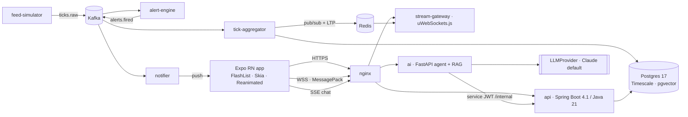

# Arth: real-time market terminal + AI portfolio copilot

A React Native (Expo SDK 58) app for Indian retail investors:
- live watchlists that update several times a second over one socket;
- Skia candlestick charts;
- portfolio import from a broker tradebook or a CAS statement;
- a copilot that answers "why is my portfolio down today?" from your own numbers, with charts and citations, and refuses to give investment advice.

> Prices are simulated by design. Arth is not a SEBI-registered adviser.

## Problem

Retail investors in India have two kinds of tool:
- **Broker apps:** they show prices but don't explain your portfolio.
- **Chat assistants:** they explain things but make up numbers and slide into stock tips.

Arth tries to do both honestly:
- **Prices:** stay fast on cheap phones and patchy networks.
- **Answers:** every number traces to a tool call over your own data.
- **Compliance:** consent and erasure follow India's DPDP Act, and the SEBI line holds against "what should I buy?".

## Market validation

- India had about **23.4 crore demat accounts** in July 2026, with CDSL at 18.8 crore and NSDL at 4.6 crore ([report](https://newsable.asianetnews.com/business/demat-account-additions-surge-in-july-2026-reach-234-4-million-articleshow-hykhvbp)). NSDL alone reported 4.77 crore accounts in October 2026 ([report](https://www.devdiscourse.com/article/business/4005290-nsdls-assets-under-custody-cross-usd-6-trillion-demat-accounts-reach-477-crore)). These come from secondary reports; check the NSDL and CDSL monthly data before you quote them.
- Accounts are growing faster than the number of *active* investors ([Business Today, Sep 2026](https://www.businesstoday.in/personal-finance/story/demat-accounts-are-growing-faster-than-active-investors-what-does-it-mean-for-brokerages-554079-2026-09-09)). The new investor is often first-time, mobile-only and on a budget phone. That is the user the performance budgets and the plain-language copilot are built for.

## Demo

| Watchlist streaming | Chart gestures | Copilot answer + refusal |
|---|---|---|
| `docs/media/watchlist.gif` *(to record)* | `docs/media/chart.gif` *(to record)* | `docs/media/copilot.gif` *(to record)* |

How to record each GIF:
1. Run `adb shell screenrecord --time-limit 15 /sdcard/x.mp4` and do the shot (scripts are in `docs/release/RELEASE.md`).
2. Pull it with `adb pull /sdcard/x.mp4`.
3. Convert it with `ffmpeg -i x.mp4 -vf "fps=12,scale=360:-1:flags=lanczos" docs/media/watchlist.gif`.

## Architecture



For details see:
- [`docs/ARCHITECTURE.md`](docs/ARCHITECTURE.md): protocol, topics, data model, AI design;
- [`docs/OBSERVABILITY.md`](docs/OBSERVABILITY.md): metrics, traces, Sentry, k6, Maestro.

## Performance (measured; see [`docs/perf/REPORT.md`](docs/perf/REPORT.md))

All measured on a Ryzen 7 5700U laptop with 7.2 GB RAM. Report row IDs are in brackets.

| What | Result |
|---|---|
| End-to-end fan-out, 1,000 sockets × 50 symbols | 3,985 frames/s, 40,960 delta rows/s [R6] |
| Source tick → client latency | p50 177 ms · p95 313 ms · p99 350 ms [R7] |
| Integrity | 0 sequence gaps, 0 errors [R8] |
| Gateway at 1,000 sockets | 132 MB RSS · 6.4 % CPU [R10] |
| Bandwidth per client | 1.80 KB/s [R9] |
| Aggregator | 100k ticks in 23 ms on one core; consumer lag 0 [R2, R4] |
| Full Docker stack via nginx, 300 sockets | p50 183 ms · p99 360 ms [R12] |
| Android Hermes bundle | 5.3 MB [M1] |
| Copilot evals | 63/63; holdout regex-guard recall 0.20, reported as-is [A1, A2] |

Not yet measured: cold start, scroll and chart FPS, the memory soak and k6. The budgets and the exact commands are in REPORT.md under "Not measured".

## Stack

| Layer | Tech |
|---|---|
| Mobile | Expo SDK 58, Expo Router, FlashList, Skia, Reanimated, zustand, TanStack Query, MMKV, expo-sqlite, Sentry, en/hi i18n |
| Realtime | Node 24, `@platformatic/kafka`, Redis 8, uWebSockets.js, MessagePack |
| API | Spring Boot 4.1, Java 21, PostgreSQL 17 + TimescaleDB, Flyway, springdoc |
| AI | FastAPI, Python 3.13, uv, pgvector hybrid RAG, Claude (pluggable `LLMProvider`), Groq Whisper |
| Infra | Docker Compose profiles (`core`, `realtime`, `ai`, `obs`), nginx, Prometheus, Grafana, Jaeger/OTel, k6, Maestro, EAS |

## Run it

Prerequisites: Node ≥ 22, pnpm, Java 21, uv, Docker. Android Studio is needed for the app. **Keys and env files (including the AI keys) are listed in [`SETUP.md`](SETUP.md); all are optional.**

```sh
pnpm install && pnpm build
docker compose -f infra/docker-compose.yml --profile core --profile realtime up -d --build   # add --profile ai, --profile obs
cd apps/mobile && npx expo run:android
```

- nginx listens on `:7080` (HTTP) and `:7443` (TLS).
- The dev OTP code is printed in `docker logs arth-api-1`.
- Without an `ANTHROPIC_API_KEY`, the copilot uses a scripted provider. To run the copilot alone:

  ```sh
  cd services/ai && uv sync && AI_BACKEND=memory .venv/bin/uvicorn arth_ai.main:app --port 8090
  ```

Tests:
- `pnpm turbo run typecheck lint test` (TS);
- `cd services/ai && .venv/bin/python -m pytest` (AI);
- `cd services/api && ./gradlew test` (API; needs Docker for Testcontainers).

## Docs

- [Build plan](docs/PLAN.md) · [Changelog](docs/CHANGELOG.md) · [Progress](PROGRESS.md)
- [Interview notes: 10 hardest decisions](docs/INTERVIEW_NOTES.md) · [Resume bullets](docs/RESUME_BULLETS.md)
- [Privacy policy and DPDP notice](docs/legal/PRIVACY_POLICY.md) · [Release kit: EAS, Play checklist, listing, demo script](docs/release/RELEASE.md)
