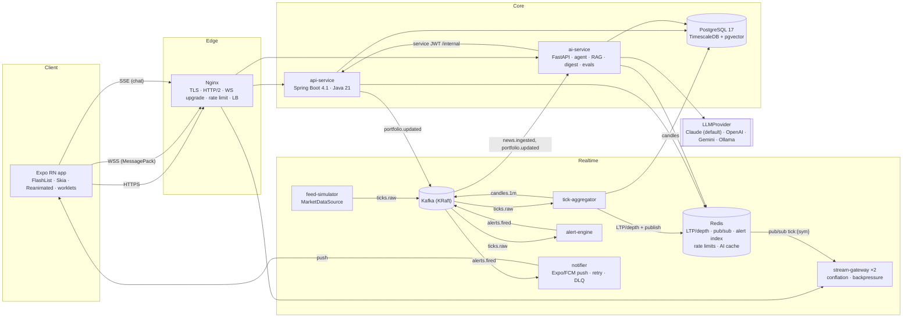
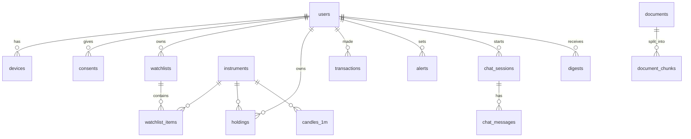

# Arth — Architecture

Real-time market terminal + AI portfolio copilot for Indian retail investors. The React Native app is the centerpiece; the backend exists to feed it realistic, high-rate data and grounded AI answers.

## 1. System diagram



## 2. Services

| Service | Stack | Responsibility |
|---|---|---|
| feed-simulator | Node 24 / TS | GBM with intraday U-shaped volatility, volume bursts, NSE hours 09:15–15:30 IST (with a `--always-open` dev flag), circuit limits (5/10/20%), 2,000+ symbols, configurable ticks/s. `MarketDataSource` interface; `SimulatedSource` + `BrokerSourceStub` (Upstox/Kite-shaped). |
| tick-aggregator | Node / TS (kafkajs) | Consume `ticks.raw` (key = symbol). Maintain 1m OHLCV in memory, write `ltp:{sym}` / `depth:{sym}` hashes, publish `tick:{sym}`, batch-insert closed candles into Timescale, emit `candles.1m`. |
| stream-gateway | Node + uWebSockets.js | WS server. Per-connection subscription set; Redis pub/sub fan-out (pattern-free, ref-counted channel subs per instance); 250 ms conflation; backpressure (drop-to-latest when buffered > 64 KB); per-connection `seq`; snapshot on subscribe/resync. Stateless → horizontally scalable. |
| api-service | Spring Boot 4.1, Java 21, Flyway | OTP auth, JWT access + rotating refresh (reuse detection), users/devices, watchlists, instruments search, portfolio (CAS PDF / CSV / manual), XIRR, alerts CRUD, cursor-paginated candle history, Redis token-bucket rate limit, idempotency keys, DPDP consent/export/delete, springdoc OpenAPI. |
| alert-engine | Node / TS | Alerts indexed per symbol in Redis (sorted sets on threshold); evaluate on ticks; dedupe (fire-once + cooldown key); emit `alerts.fired`. |
| notifier | Node / TS | Consume `alerts.fired` + `digest.ready`; send via Expo Push (FCM/APNs under the hood); exponential retry; DLQ `notifications.dlq`. |
| ai-service | Python 3.12, FastAPI, uv | Agent loop + tools, SSE streaming, RAG ingestion/search, guardrails, digest scheduler, eval runner, voice transcription proxy. |
| nginx | nginx | TLS (self-signed in dev), HTTP/2, `/ws` upgrade, gzip, per-IP `limit_req`, round-robin over 2× api + 2× gateway. |
| observability | OTel Collector, Prometheus, Grafana | ticks/s, consumer lag, WS connections, p95s, LLM tokens/cost; JSON logs everywhere. |

**Decision — gateway language:** the prompt allows Go or Node/uWebSockets. Realtime services are Node/TS so they share the generated proto types with the app and with each other, and uWebSockets.js is C++ underneath (comparable connection density to Go). No Go toolchain is needed.

## 3. Data flow: one tick, end to end

1. Simulator emits `Tick` (protobuf) → `ticks.raw`, partitioned by symbol.
2. Aggregator updates candle + Redis hash, `PUBLISH tick:RELIANCE <msgpack>`.
3. Each gateway instance subscribed to that channel (because ≥1 of its clients subscribed) puts the tick into each interested connection's conflation map (overwrite).
4. Every 250 ms the gateway flushes one binary `DELTA` frame per connection (skipped if the socket is backpressured; the map keeps only the latest).
5. App: WS `onmessage` → raw `ArrayBuffer` handed to a **worklet runtime** → MessagePack decode + merge into a batch → every 100–250 ms one batch crosses to JS → `tickStore.applyBatch()`.
6. Only rows whose symbol changed re-render (per-symbol selector); flash animation runs on the UI thread via a Reanimated shared value.
7. Perf mark `tick→paint` = server `ts` vs `onLayout`/commit timestamp, sampled.

## 4. Wire protocol (app ⇄ stream-gateway)

- Client → server: small JSON text frames: `{op:"sub",symbols:[…]}`, `{op:"unsub",symbols:[…]}`, `{op:"resync"}`, `{op:"ping"}`, `{op:"rate",ms:1000}` (slow networks).
- Server → client: binary MessagePack array `[type, seq, payload]`
  - `0 SNAPSHOT` — `{SYM: [ltp, prevClose, high, low, volume, bids[5][2], asks[5][2]]}`
  - `1 DELTA` — `[[symIdx, ltp, volume, high, low, tsMs], …]` (`symIdx` assigned per connection in the `SUB_ACK` → tiny frames)
  - `2 SUB_ACK` — `{SYM: symIdx}`; `3 DEPTH` — `{symIdx: [bids, asks]}` (only for symbols in "depth" mode, i.e. the open instrument screen); `4 PONG`; `5 ERROR`.
- `seq` is per connection, monotonically increasing. A gap (`seq ≠ last + 1`) → client sends `resync` → server sends `SNAPSHOT` for current subs and resets `seq`.
- Reconnect: client resends its full desired subscription set; server replies `SUB_ACK` + `SNAPSHOT`.

## 5. Kafka topics (Protobuf, versioned `.proto` in `packages/proto`)

| Topic | Key | Partitions | Message |
|---|---|---|---|
| `ticks.raw` | symbol | 12 | `Tick{symbol, ltp, volume, bids[5], asks[5], ts_ms, seq}` |
| `candles.1m` | symbol | 12 | `Candle{symbol, open, high, low, close, volume, bucket_start_ms}` |
| `alerts.fired` | user_id | 6 | `AlertFired{alert_id, user_id, symbol, condition, trigger_price, ts_ms}` |
| `digest.ready` | user_id | 3 | `DigestReady{user_id, digest_id, title}` |
| `notifications.dlq` | user_id | 1 | `FailedNotification{payload, reason, attempts}` |
| `portfolio.updated` | user_id | 6 | `PortfolioUpdated{user_id, version, ts_ms}` |
| `news.ingested` | doc_id | 6 | `NewsIngested{doc_id, symbols[], source, url, published_ms}` |
| `user.deleted` | user_id | 6 | `UserDeleted{user_id, ts_ms}`. Every service that keeps per-user state (alert-engine index, ai chat cache, notifier device list) purges on receipt (DPDP erasure). |

Generated code: TS (`ts-proto`) for Node services, Java (`protoc` via Gradle plugin) for api, Python (`betterproto`) for ai.

## 6. REST contracts

**api-service** (OpenAPI 3.1 via springdoc → `packages/api-client` via `openapi-typescript` + `openapi-fetch`). Errors are RFC 7807 problem+json. All non-GET writes accept `Idempotency-Key`.

| Area | Endpoints |
|---|---|
| Auth | `POST /v1/auth/otp/request` · `POST /v1/auth/otp/verify` · `POST /v1/auth/refresh` · `POST /v1/auth/logout` |
| Me / DPDP | `GET/PATCH /v1/me` · `POST /v1/me/devices` · `GET/PUT /v1/me/consents` · `GET /v1/me/export` · `DELETE /v1/me` |
| Instruments | `GET /v1/instruments?q=&cursor=&limit=` · `GET /v1/instruments/{symbol}` · `GET /v1/instruments/{symbol}/candles?tf=1m\|5m\|15m\|1d&before=&limit=` (cursor = bucket time) |
| Watchlists | `GET/POST /v1/watchlists` · `PATCH/DELETE /v1/watchlists/{id}` · `PUT /v1/watchlists/{id}/items` (ordered list, ≤200) · `PUT /v1/watchlists/order` |
| Portfolio | `POST /v1/portfolio/import/cas` (multipart + password) · `POST /v1/portfolio/import/csv` · `GET/POST /v1/portfolio/holdings` · `PATCH/DELETE /v1/portfolio/holdings/{id}` · `GET /v1/portfolio/summary` · `GET /v1/portfolio/allocation?by=sector\|mcap\|asset` · `GET /v1/portfolio/history?range=` |
| Alerts | `GET/POST /v1/alerts` · `PATCH/DELETE /v1/alerts/{id}` |
| Internal | `/internal/v1/users/{id}/holdings`, `/metrics`, `/exposure`, `/compare` (service JWT, not exposed by nginx) |

**ai-service:** `POST /v1/chat/sessions` · `GET /v1/chat/sessions/{id}` · `POST /v1/chat/sessions/{id}/messages` → SSE events `token`, `tool` (status), `block`, `citation`, `done`, `error` · `GET /v1/digest/today` · `POST /v1/voice/transcribe` (Whisper-compatible, Groq default).

## 7. Data model (PostgreSQL 17 + TimescaleDB + pgvector)



- `users(id uuid, phone_e164 unique, name, locale, created_at, deleted_at)`
- `devices(id, user_id, expo_push_token, platform, last_seen_at)`
- `consents(user_id, purpose enum[core, ai_copilot, push, analytics], granted bool, version, at)` — append-only log
- `instruments(symbol pk, isin, name, sector, mcap_bucket, asset_class, lot_size, tick_size, prev_close)`
- `watchlists(id, user_id, name, position)` · `watchlist_items(watchlist_id, symbol, position)` — check ≤200 per list
- `holdings(id, user_id, symbol, qty, avg_cost, source enum[cas,csv,manual], imported_at)`
- `transactions(id, user_id, symbol, side, qty, price, traded_on)` — for XIRR
- `alerts(id, user_id, symbol, kind enum[above,below,pct_move], value, active, last_fired_at)`
- `candles_1m(symbol, bucket timestamptz, o,h,l,c numeric, v bigint)` — hypertable, compression after 7 days; continuous aggregates `candles_5m`, `candles_15m`, `candles_1d`
- `documents(id, source, url, title, symbols text[], published_at, kind enum[filing,result,news])`
- `document_chunks(id, document_id, ord, text, tsv tsvector GIN, embedding vector(1024) HNSW)`
- `chat_sessions(id, user_id, title, created_at)` · `chat_messages(id, session_id, role, content, blocks jsonb, citations jsonb, tokens_in, tokens_out)`
- `digests(id, user_id, for_date, items jsonb, data_version)` unique(user_id, for_date)
- support: `refresh_tokens(id, user_id, family_id, hash, revoked_at)`, `idempotency_keys(key, user_id, response, expires_at)`, `ai_usage(user_id, day, tokens)`

Schema ownership: api-service owns `public` (Flyway); ai-service owns schema `ai` (documents/chunks/chat/digests/usage, Alembic).

## 8. AI copilot

- **Agent loop:** `LLMProvider.stream(messages, tools)` → run tool calls (parallel when independent, max 6 steps) → stream final tokens. Providers: `AnthropicProvider` (default), `OpenAIProvider`, `GeminiProvider`, `OllamaProvider`, selected by env.
- **Tools:** `get_holdings`, `get_portfolio_metrics(range)`, `get_price_history(symbol, range)`, `get_sector_exposure`, `compare_to_index(index, range)`, `search_filings(query, symbols)`, `search_news(query, symbols, since)`, `explain_term(term)`. Portfolio tools call api-service `/internal` with a service JWT scoped to the user.
- **Grounding check:** every number in the final answer must appear in (or be derivable by rounding from) a tool result in this turn; a post-check flags unsupported numbers and triggers one regeneration, else strips the claim.
- **Generative UI:** the model calls a `render_block` pseudo-tool (`line_chart`, `allocation_donut`, `holdings_table`, `stock_chips`); args are validated with Pydantic, data is filled from tool results (not model-typed numbers), and sent as `block` SSE events rendered natively.
- **RAG:** ingest (seed corpus of public NSE announcements/results summaries + news, plus a scheduled fetcher behind a `NewsSource` interface) → clean → chunk (~400 tokens, 60 overlap, heading-aware) → embed → pgvector + `tsvector`. Query: FTS top-30 ∪ vector top-30 → reciprocal rank fusion → rerank (cross-encoder `bge-reranker` locally, LLM rerank fallback) → top-6 with citations (doc id, title, url, date).
- **Prompt-injection defense:** retrieved text wrapped in `<untrusted_document>` tags, system prompt declares them data-only, instruction-like spans flagged by a heuristic classifier and neutralized; tools are read-only and user-scoped, so even a successful injection cannot exfiltrate other users' data.
- **Compliance guard (SEBI):** (1) system prompt; (2) output guard = regex/lexicon pre-filter + small LLM classifier on the final answer for advice/targets; (3) on hit → refusal template with educational reframing; (4) disclaimer rendered on every assistant message.
- **DPDP:** AI features gated on the `ai_copilot` consent; PAN/email/phone masked before any LLM call; delete cascades to chats, digests, usage.
- **Budgets & cache:** per-user daily token budget (`ai_usage`), Redis response cache keyed `(user, normalized question, portfolio version, corpus version)`.
- **Evals:** `services/ai/evals/*.jsonl` (≥40 cases: numeric grounding, refusals, injection, citations, Hinglish) + scorer producing groundedness and refusal precision/recall; runs in CI against a recorded-fixture provider and live on demand.

## 9. Mobile app

```
apps/mobile/
  app/                       Expo Router (typed routes)
    (auth)/  phone, otp, consent
    (tabs)/  watchlist, explore, portfolio, copilot, alerts
    instrument/[symbol].tsx  digest/[date].tsx  settings/…
  src/
    realtime/   socket.ts (backoff+jitter, heartbeat, AppState + NetInfo aware)
                decoder.worklet.ts (MessagePack decode + batching on a worklet runtime)
                tickStore.ts (zustand + subscribeWithSelector, per-symbol slices)
                viewportSubscriptions.ts (viewability diff, buffer, debounce)
    charts/     CandleChart (Skia), viewport/culling, path cache, gestures, indicators (SMA/EMA/RSI/VWAP)
    features/   auth · watchlist · explore · instrument · portfolio · copilot · alerts · digest
    data/       api client, TanStack Query (persisted to MMKV), SQLite (candles, chat history)
    ui/         theme (dark/light, dynamic type), a11y price labels, i18n (en, hi)
    observability/ Sentry, perf marks
```

Key guarantees: rows are `memo` components reading only their symbol's slice; `renderItem`/`keyExtractor`/`getItemType` are stable module-level functions; no tick ever touches React state above the row. Chart drawing and crosshair are Skia + Reanimated derived values on the UI thread; only visible candles (+1 screen of overscan) are turned into paths, cached per (timeframe, viewport window).

## 10. Security

JWT access (15 min) + rotating refresh tokens with family-based reuse detection, stored in `expo-secure-store` · biometric app lock · OTP through a pluggable `SmsProvider` (dev provider logs the code; rate-limited per phone) · service-to-service JWT for `/internal` · nginx + Redis rate limits · secrets only in `.env` (`.env.example` committed).

## 11. Environment constraints (this dev machine)

16 cores, ~7.5 GB RAM, Docker Desktop VM capped at ~4 GB, Android emulator with KVM available, no physical Android device attached. Consequences:

- Compose uses one Kafka broker, small JVM heaps, and a `profile` split (`core`, `realtime`, `ai`, `obs`) so not everything has to run at once; the load test runs the realtime profile only.
- Mobile perf numbers will be measured on the emulator and labelled as such; the mid-range-device budget needs a physical Redmi/Realme-class phone, and the report will say which numbers are still pending a device run.
- Backend load numbers are reported with the exact hardware and container limits.
